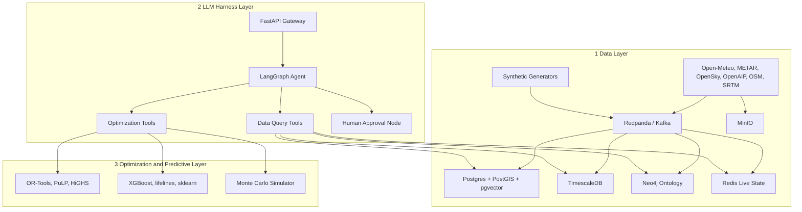

# GARUDA Architecture

Global Air Resource & Unified Decision Architecture: a backend-first decision-support platform for planning and dynamically retasking air operations (Indian MoD / IAF context). Hackathon prototype, one theatre, **all military data synthetic and unclassified**.

## Three layers



## Layer responsibilities
| Layer | Responsibility | Docs |
|---|---|---|
| Data | Ingest real feeds, generate synthetic data, store in the right engine, expose via repositories | `docs/01_data_layer/` |
| LLM harness | Natural-language interface; LangGraph agent searches data and calls optimization tools; human approval gate | `docs/02_llm_harness/` |
| Optimization / predictive | Deterministic solvers and ML models exposed as typed tools | `docs/03_optimization_layer/` |

## Key principles
1. The LLM never computes plans. It retrieves data and calls solvers, then explains results.
2. Every tool has a Pydantic input/output schema (RORO).
3. Any action that changes tasking requires human approval (see `guardrails_and_hitl.md`).
4. Every solver returns an explanation payload (binding constraints, alternatives, KPIs).
5. Model-agnostic LLM adapter so a local model can replace the cloud API later.

## Suggested backend layout (clean architecture)
```
backend/
  app/
    main.py                # FastAPI app, lifespan
    api/routers/           # chat_routes.py, plan_routes.py, scenario_routes.py
    harness/               # graph.py, state.py, nodes/, tools/
    optimization/          # one module per algorithm
    ml/                    # models, training, registry
    data/                  # repositories (pg, neo4j, redis, ts), generators, ingestors
    schemas/               # pydantic models
  docker-compose.yml
```

## Deployment (docker-compose)
Services: `postgres` (PostGIS+Timescale+pgvector image), `neo4j`, `redis`, `redpanda`, `minio`, `backend` (FastAPI), `generator` (synthetic event simulator), `ingestor` (real feeds). Optional: `grafana` for monitoring.

## Data flow for a dynamic retasking event
1. Generator emits `aircraft.status` event (tail goes NMC) to Redpanda.
2. Consumers update Postgres, Timescale, Neo4j, Redis.
3. Event is pushed over SSE to the UI and flagged to the agent.
4. User or agent asks "retask"; agent fetches affected missions, calls `rolling_horizon_retask`.
5. Proposed plan shown with KPIs; human approves; approved plan written back.
