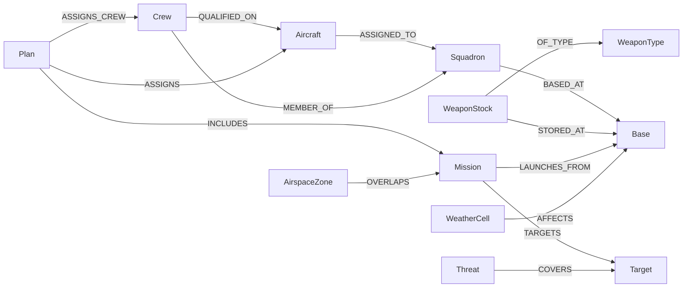

# GARUDA Ontology

A Palantir-style object model stored as a graph in Neo4j (system of record for relationships) with attributes mirrored in Postgres/Redis. IDs are shared across stores (`uuid` or business key).

## Object types
| Label | Key | Core properties |
|---|---|---|
| `Base` | `base_id` | name, icao, lat, lon, runway_count, fuel_capacity_l, shelter_count |
| `Squadron` | `sqn_id` | number, role, aircraft_type, base_id |
| `Aircraft` | `tail_no` | type, status, fuel_state, flight_hours, next_maint_due |
| `Crew` | `crew_id` | name, role, qualifications, fatigue_score, duty_hours_24h |
| `WeaponType` | `weapon_code` | category, range_km, weight_kg, pk_by_target_class |
| `WeaponStock` | `stock_id` | base_id, weapon_code, quantity |
| `LoadConfig` | `config_id` | aircraft_type, station_map, mission_roles |
| `Mission` | `mission_id` | type, priority, window_start, window_end, status |
| `Target` | `target_id` | class, lat, lon, value, hardness |
| `Threat` | `threat_id` | type, lat, lon, range_km, confidence, last_seen |
| `AirspaceZone` | `zone_id` | type, geometry, floor_ft, ceiling_ft, active_from/to |
| `WeatherCell` | `cell_id` | lat, lon, valid_time, ceiling_ft, vis_km, wind, cb_flag |
| `Tanker` | extends Aircraft | offload_kg, orbit_id |
| `Plan` | `plan_id` | created_by, objective, kpis, status |

## Relationships


Relationship properties: `ASSIGNS {sortie_no, load_config_id, depart_time, tot}`, `COVERS {pk_estimate}`.

## Example Cypher
```cypher
// Aircraft at a base that are FMC and have qualified crew available
MATCH (a:Aircraft {status:'FMC'})-[:ASSIGNED_TO]->(:Squadron)-[:BASED_AT]->(b:Base {base_id:$base})
MATCH (c:Crew)-[:QUALIFIED_ON]->(a)
WHERE c.fatigue_score < 0.6
RETURN a.tail_no, collect(c.crew_id) AS crews
```

## Constraints (Neo4j)
```cypher
CREATE CONSTRAINT aircraft_pk IF NOT EXISTS FOR (a:Aircraft) REQUIRE a.tail_no IS UNIQUE;
CREATE CONSTRAINT base_pk IF NOT EXISTS FOR (b:Base) REQUIRE b.base_id IS UNIQUE;
CREATE CONSTRAINT mission_pk IF NOT EXISTS FOR (m:Mission) REQUIRE m.mission_id IS UNIQUE;
```
