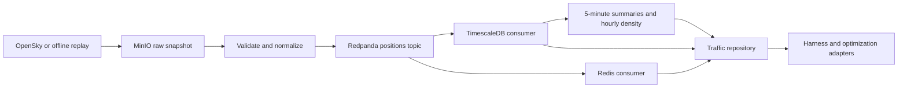

# Air Traffic (ADS-B): Implementation Plan

## Goal and scope

Ingest observed air traffic from OpenSky, retain spatial history, maintain fresh
live positions, and support the demo, traffic-density queries, and
`get_civil_traffic`. Use [storage architecture](storage_architecture.md) for store
ownership and event conventions, and [synthetic generation](synthetic_data_generation.md)
for deterministic seeds and scenario replay. Those documents provide design
context; unrelated stores and generators are outside this implementation.

**Status: ADS-B application implementation verified locally.** The backend package,
locked dependencies, contracts, deterministic replay, schema migration, archive,
publisher/consumers, live cache, OpenSky adapter, and repository interfaces are
implemented. The four store cases plus an offline end-to-end case passed on
2026-10-04. See the
[storage setup README](../../infra/adsb/README.md) for runnable commands and pins.

## 1. Dockerized storage

| Service | Responsibility | Dockerfile | Persistence |
|---|---|---|---|
| TimescaleDB with PostGIS | Authoritative normalized observations, spatial history, aggregates | `infra/adsb/timescaledb/Dockerfile` | PostgreSQL named volume |
| Redis | Disposable live GEO and metadata projection | `infra/adsb/redis/Dockerfile` | Redis named volume; rebuildable |
| Redpanda | Kafka-compatible positions topic and event replay | `infra/adsb/redpanda/Dockerfile` | Broker named volume |
| MinIO | Original OpenSky responses and replay manifests | `infra/adsb/minio/Dockerfile` | Object-store named volume |

Use one PostgreSQL service with both TimescaleDB and PostGIS, consistent with the
overview's shared deployment. ADS-B facts belong to its hypertable; Redis remains
a projection. No separate plain PostgreSQL or Neo4j service is needed for ADS-B.
The [official Timescale HA image](https://github.com/timescale/timescaledb-docker-ha)
includes PostGIS and can run as a single local server.

Each service gets its own Dockerfile, even when it only wraps a pinned upstream
image and copies configuration. One `infra/adsb/compose.yaml` connects them,
defines health checks, waits for initialization, and includes a test-runner
profile. Pin exact image versions and digests; lock Python test dependencies.
Keep credentials and host-port overrides in an ignored `.env`, with a committed
`.env.example`. Bind published ports to localhost; container clients use service
names. Configure Redpanda with separate internal and host-advertised listeners.

Initialization enables extensions and creates topics idempotently. Domain schema
changes use Alembic rather than first-start Docker scripts, so existing volumes
can be upgraded. Each store has its own named volume; ordinary shutdown preserves
data, while an explicit reset removes this stack's volumes. Record tested image
pins and commands in the infrastructure README.

**MinIO image selected:** use the prebuilt
`coollabsio/minio:RELEASE.2025-10-15T17-29-55Z` image, pinned to
`sha256:69b55a1c1c5dc285ce04db96689f5b2102317fc77a50680a1874ca6efd1c87f9`.
[Coollabs](https://github.com/coollabsio/minio) publishes community builds from
upstream source releases; its included `mc` client supplies readiness checks.
No custom source build or AIStor license setup is needed. The
[upstream community repository](https://github.com/minio/minio) is no longer
maintained; assess long-term support before a production deployment.

## 2. Pipeline and source adapter



Poll `GET https://opensky-network.org/api/states/all` using the scenario's
`lamin`, `lomin`, `lamax`, and `lomax`. Validate the bounding box and configure
timeouts. A 15–30-second cadence is suitable for short demos; continuous operation
must also budget for account credits and bounding-box cost. Support anonymous
access and OAuth2 client credentials, cache tokens by their expiry, and refresh
once on HTTP 401. Respect `X-Rate-Limit-Retry-After-Seconds` or `Retry-After` on
429; otherwise use capped exponential backoff with jitter. Retry transient
transport/5xx failures and report degraded feed status. These behaviors follow
the [OpenSky REST specification](https://github.com/openskynetwork/opensky-api/blob/master/docs/free/rest.rst).

Archive each successful response before publishing normalized positions. Use a
checksum-based object key and manifest containing source, bounding box, response
time, ingestion time, checksum, and schema version. Do not store authentication
headers. If publication fails, retain a pending manifest for retry; reconciliation
must recover snapshots archived immediately before a producer crash.

## 3. Observation and event contracts

Map the positional arrays according to the
[OpenSky state-vector specification](https://github.com/openskynetwork/opensky-api/blob/master/docs/free/states-response.rst):

| Index | Source value | Normalized value |
|---|---|---|
| 0, 1, 2 | ICAO24, callsign, origin country | Lowercase `icao24`, trimmed nullable `callsign`, `origin_country` |
| 3, 4 | Position time, last contact | UTC `time`, `last_contact` |
| 5, 6 | Longitude, latitude | `lon`, `lat`; geometry uses `(lon, lat)` |
| 7, 13 | Barometric, geometric altitude | Nullable `alt_m`, `geo_alt_m` |
| 8 | On ground | `on_ground` |
| 9, 10, 11 | Ground speed, track, vertical rate | Nullable `speed_ms`, `heading`, `vrate` |
| 16 | Position source | `position_source` provenance |

Pydantic validates finite numbers, coordinate bounds, nonnegative speed, headings
in `[0, 360)`, and six-character hexadecimal ICAO24. Preserve unknown altitude
and kinematic values as null. Null `states` is a valid empty response. Missing
position time or coordinates excludes a row from position events but leaves its
raw snapshot available. Count malformed rows without discarding valid neighbors;
accept documented optional trailing fields. Never replace missing position time
with poll time. Observations alone do not establish that an aircraft is civil.

Use the existing envelope fields `event_id`, `type`, `entity_id`, `ts`, `version`,
and `payload`. Set `type=adsb.position.observed`, `entity_id=icao24`, `ts` to position
time, and `version` to its Unix seconds. Payload includes normalized fields,
`source_id`, schema version, original response/ingestion timestamps, and snapshot
pointer. Generate deterministic UUIDv5 identity from source, ICAO24, and position
timestamp. The first validated observation at that identity wins; repeated polls
are duplicates and do not extend freshness. Any future correction protocol must
explicitly revise this contract.

Partition `garuda.adsb.positions` by ICAO24; use delete cleanup and seven-day
retention, with three partitions and replication factor one locally. Use a
separate dead-letter topic for unrecoverable records. Live and history consumers
have separate groups, commit offsets after their own successful writes, and are
idempotent under at-least-once delivery. There is no cross-store transaction.

## 4. TimescaleDB schema and derived data

Implement versioned migrations for:

- `adsb_track(time, source_id, icao24, callsign, origin_country, last_contact,
  lat, lon, geom, alt_m, geo_alt_m, speed_ms, heading, vrate, on_ground,
  position_source, ingested_at, snapshot_key)`.
- UTC `TIMESTAMPTZ` time, generated `geometry(Point,4326)`, and primary key
  `(time, source_id, icao24)`, including the hypertable partition column.
  Insert with `ON CONFLICT DO NOTHING` for duplicate observations.
- One-hour chunks, `(source_id, icao24, time DESC)` index, SQL validation
  constraints, and a GiST geography expression index for distances in meters.
- `adsb_track_5m` continuous aggregate grouped by source, ICAO24, and five-minute
  bucket, with sample count, altitude range, and mean speed. Do not average
  headings or expose averaged positions as exact flight paths.

Retain raw observations for 24 hours and five-minute summaries for 30 days.
Refresh summaries every minute with a 23-hour lookback and five-minute end offset;
refresh windows must not overlap deleted raw history. Older late arrivals go to
an explicit backfill path, materialized before raw deletion. Alert on stalled
refresh jobs before resuming retention after a long outage. The
[Timescale retention guidance](https://docs.timescale.com/use-timescale/latest/data-retention/data-retention-with-continuous-aggregates/)
explains how refreshing deleted raw ranges can remove aggregate results.
Chunk-based deletion is approximate; repository queries enforce the logical
24-hour raw-data cutoff.

For density, start with configurable 0.05-degree grid cells and hourly buckets.
Persist unique `(source_id, hour, cell_id, icao24)` occupancy for 30 days and count
its rows per cell/hour. This counts aircraft rather than polling samples and
avoids summing distinct counts across five-minute buckets. Exclude on-ground
observations by default. Return cell-size metadata because degree-based cells
vary in physical size with latitude.

## 5. Redis freshness

Use `adsb:live` for live-source GEO membership, `adsb:track:{icao24}` for payloads,
and `adsb:live:expires` for per-aircraft freshness deadlines. The intended live
lifetime is 120 seconds from position time, not delivery time. Replay uses
equivalent keys under a separate run-specific prefix.

GEO membership is a sorted set, so a whole-key TTL cannot expire one aircraft.
Use a Lua operation to compare versions and atomically update location, payload,
and deadline only for newer, still-fresh positions. A five-second janitor removes
expired members atomically. Reads independently reject expired or missing
metadata, preventing janitor lag from exposing stale positions. Duplicates and
delayed broker delivery cannot extend freshness or regress location. Redis's
[GEOADD documentation](https://redis.io/docs/latest/commands/geoadd/)
describes its representation and supported latitude bounds; points outside those
bounds remain available through PostGIS.

## 6. Offline replay and access interfaces

Provide a small, clearly labelled fabricated OpenSky-shaped fixture, its checksum,
and optional attributed recorded samples when available. Additional background
traffic uses `numpy.random.default_rng(GARUDA_SEED)` and the scenario bounding
box. Keep it separate from synthetic assets in other domains.

Inject a clock and configurable speed into replay. Deterministically shift fixture
position/contact times to the scenario start, preserving original timestamps in
provenance. The same fixture, seed, start time, and replay ID produce identical
events; run-specific source IDs isolate history, cache, and aggregates. Tests do
not require OpenSky credentials. Demo fallback must label replay explicitly and
must not imply that an empty or stale feed proves empty airspace.

Implement `TrafficRepository` with asyncpg and redis.asyncio:

- `get_live(polygon, as_of, limit)`: fresh positions with exact polygon filtering.
- `get_history(polygon, since, until, source_id, limit)`: parameterized spatial/time
  queries and stable pagination within the raw retention window.
- `get_density(polygon, since, until, source_id)`: hourly aircraft occupancy.
- `get_civil_traffic(TrafficQuery)`: harness adapter returning bounded items,
  `data_as_of`, source, coverage status, and truncation flags.

Consumers use repositories rather than raw connections. Query roles receive
SELECT access to approved relations and bounded query timeouts. Conflict-candidate
queries use 10,000 m lateral distance, 304.8 m vertical distance, and ±300 seconds
around an observed timestamp. Compare altitude references explicitly; unknown or
incompatible altitude produces an unknown assessment. Future motion prediction
requires a separately labelled bounded model; aggregated history is unsuitable
for exact conflict checks.

## 7. Deliverables and implementation order

```text
infra/adsb/
  compose.yaml
  .env.example
  README.md
  timescaledb/Dockerfile
  timescaledb/init/020_extensions.sql
  redis/Dockerfile
  redis/redis.conf
  redpanda/Dockerfile
  redpanda/init-topics.sh
  minio/Dockerfile
  tests/Dockerfile
  tests/requirements.lock
backend/
  app/schemas/adsb.py
  app/data/ingestors/adsb.py
  app/data/consumers/adsb_history.py
  app/data/consumers/adsb_live.py
  app/data/repositories/traffic.py
  app/data/replay/adsb.py
  migrations/versions/*_adsb.py
tests/
  integration/test_adsb_stores.py
  fixtures/adsb/sample.json
```

| Phase | Deliverables | Acceptance gate |
|---|---|---|
| 1. Infrastructure | Four store Dockerfiles, Compose, health checks, pinned inputs, init scripts, test runner | Clean startup, all four store tests pass, restart preserves volumes |
| 2. Offline contract | Pydantic models, config, fixture, clock, seeded replay and CLI | Deterministic outputs; null/malformed rows handled; live/replay separated |
| 3. Durable ingestion | Alembic schema, archive/manifest adapter, Kafka publisher and history consumer | Duplicate-safe writes; pending snapshots recover after publish failure |
| 4. Live cache and aggregates | Redis version checks/janitor, summaries, retention and density | Stale/late events cannot regress live state; distinct density and retained summaries are correct |
| 5. Live feed | HTTP/OAuth adapter, quota-aware polling, retries and metrics | Mock HTTP cases cover 401/429/5xx/timeout/empty feed |
| 6. Consumers | Repository, harness adapter, density/conflict-candidate adapters | Offline end-to-end replay; spatial/time/altitude boundaries and unknowns verified |

Observe poll age, validated/dropped row counts, remaining API credits, pending
archives, publish failures, consumer lag, expiry removals, and aggregate-job age.
Before completion, exercise consumer failure after a store write but before offset
commit, broker restart/replay, and Redis rebuild from recent history.

## 8. Single database testing file

Implemented **one file, `tests/integration/test_adsb_stores.py`, with four
independent test cases**, one for each store. Each case uses unique test resources
and cleans up only those resources. Store unavailability fails the test; it is
not reported as a skipped success.

| Test case | Required checks |
|---|---|
| `test_timescaledb_spatial_history` | Extensions enabled; isolated hypertable insert; duplicate does not add a row; spatial/time lookup and five-minute aggregate produce expected results |
| `test_redis_live_geo_and_expiry` | GEO lookup finds fresh aircraft; expiring one payload and pruning its member leaves another aircraft available |
| `test_redpanda_position_roundtrip` | Main topic has expected partitions/retention; keyed event publishes and consumes; seeking back replays the same event |
| `test_minio_raw_snapshot_roundtrip` | Upload/download OpenSky-shaped JSON; content and checksum metadata match; isolated object/bucket cleanup succeeds |

These validate infrastructure capabilities. Add ingestion, replay, failure recovery,
retention, and repository behavior tests during the corresponding phases rather
than treating the four store cases as proof of the entire pipeline.

Root-level commands:

```powershell
docker compose -f infra/adsb/compose.yaml config --quiet
docker compose -f infra/adsb/compose.yaml up --build -d
docker compose -f infra/adsb/compose.yaml --profile test run --build --rm store-tests
docker compose -f infra/adsb/compose.yaml down
```

## Setup and verification

Docker Desktop's Linux engine is now available, and the MinIO image choice is
resolved. The baseline platform is Linux amd64. For optional live acquisition,
provide OpenSky client credentials through local environment configuration;
offline implementation and tests can proceed without them. Never commit
credentials or paste them into the plan.

Verified on 2026-10-04: all four stores became healthy, topic initialization and
the ADS-B migration completed successfully, and the five Docker integration cases
passed (`5 passed`). The suite includes a fabricated offline replay through Kafka,
the independent history/live consumers, TimescaleDB and Redis. A separate focused
application suite passed eight cases (`8 passed`) for deterministic replay,
malformed/nullable rows, archive recovery, duplicate/out-of-order cache behavior,
mocked 401/429/5xx/timeout OpenSky behavior, and unknown conflict altitude.
OpenSky's current official REST documentation confirms OAuth2 client credentials,
30-minute tokens, one retry after 401, and
`X-Rate-Limit-Retry-After-Seconds` for exhausted credits.
The migration's existing-volume upgrade was exercised; a clean-volume reset was
not run because preserving the current Docker volumes was required.
