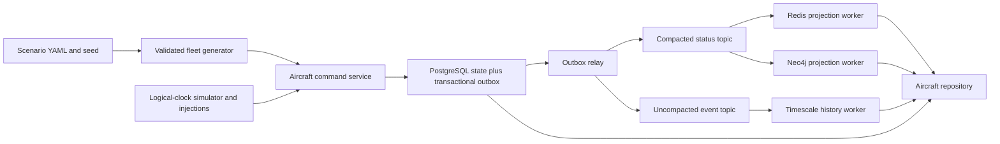

# Aircraft Availability: Implementation Plan

**Status: implemented and verified against the isolated Docker store stack.**
Prepared on 2026-10-04. The domain specification below is retained as context;
the implementation decisions following it resolve gaps in the abbreviated examples.

## Purpose
Current and forecast readiness of every airframe: can it fly, where is it, with what fuel, until when.

## Source
Synthetic (fictional fleet). Types: Su-30MKI, Rafale, Tejas, Mirage-2000, Jaguar, C-130J, IL-78 (tanker), AEW&C, helicopter.

## Schema
| Field | Type | Unit | Constraints |
|---|---|---|---|
| tail_no | text | | PK, e.g. `SU-A0123` |
| type | text | | enum of fleet types |
| sqn_id | text | | FK squadron |
| base_id | text | | FK base (current location) |
| status | text | | FMC / PMC / NMC / AOG / IN_MISSION |
| status_reason | text | | e.g. `radar_fault`, `scheduled_inspection` |
| fuel_kg | real | kg | 0..capacity |
| flight_hours_total | real | h | >= 0 |
| hours_to_next_inspection | real | h | >= 0 |
| maint_return_eta | timestamptz | | null if FMC |
| turnaround_min | int | min | per-type mean |
| capabilities | text[] | | `BVR`, `AG_PGM`, `ISR`, `AAR_RECEIVER` ... |
| range_km, cruise_kts, ceiling_ft | real | | per type |
| updated_at | timestamptz | | |

## Synthetic generation rules
- Fleet counts per `scenario_definition.md`.
- Status mix: FMC 70-75%, PMC 10-12%, NMC 13-18% (Jaguar/Mirage older: lower FMC).
- `flight_hours_total` ~ Gamma(shape=4, scale=1500 h); `hours_to_next_inspection` ~ Uniform(0, 100/200 h cycle).
- NMC repair time ~ LogNormal(mu=ln(18h), sigma=0.7).
- Events: random failure with hazard proportional to hours since inspection (feeds survival model); post-mission status degradation probability 3-5% per sortie.

## Storage
**Postgres (system of record)**
```sql
CREATE TABLE aircraft (
  tail_no text PRIMARY KEY, type text NOT NULL, sqn_id text, base_id text,
  status text NOT NULL, status_reason text, fuel_kg real,
  flight_hours_total real, hours_to_next_inspection real,
  maint_return_eta timestamptz, capabilities text[], updated_at timestamptz DEFAULT now()
);
CREATE INDEX ON aircraft (base_id, status);
```
**TimescaleDB** hypertable `aircraft_status_history(time, tail_no, status, base_id)` for forecasting training data, 90-day retention.
**Neo4j** `(:Aircraft)-[:ASSIGNED_TO]->(:Squadron)`.
**Redis** hash `ac:{tail_no}` (live status, fuel, base) + set `base:{base_id}:fmc`.
**Kafka** topic `garuda.aircraft.status` key=tail_no.

## Update frequency
Event-driven; simulator emits status changes, fuel updates every 15 sim-min.

## Sample
```json
{"tail_no":"SU-A0123","type":"Su-30MKI","base_id":"B1","status":"FMC","fuel_kg":5200,"hours_to_next_inspection":37.5,"capabilities":["BVR","AG_PGM","AAR_RECEIVER"]}
```

## Pydantic
```python
class AircraftState(BaseModel):
    tail_no: str
    type: str
    base_id: str
    status: Literal["FMC","PMC","NMC","AOG","IN_MISSION"]
    fuel_kg: float
    hours_to_next_inspection: float
    capabilities: list[str]
```

## Consumers
`get_aircraft_availability`, MILP assignment, availability forecast, sortie generation, retasking.

## 1. Scope and repository integration

Implement current aircraft readiness, deterministic fleet generation, a small
event simulator, durable history, and rebuildable live/graph projections.
Expose typed repository methods for harness and optimization consumers.
Forecast-model training, crew scheduling, mission allocation, GIS ingestion,
and a complete multi-domain simulator are later work; provide their data contracts now.

Use [storage architecture](storage_architecture.md) and
[synthetic generation](synthetic_data_generation.md) as design context.
The user's requested deliverables are a reproducible Docker deployment and
**one database integration-test file containing a case for each store**.
Commands and file paths below are planned deliverables, not runnable artifacts yet.

Follow the existing `backend/app`, Alembic, `uv.lock`, and `infra/adsb` layout.
Reuse the existing asyncpg, redis.asyncio, aiokafka, NumPy, Pydantic, and pytest
dependencies. Add exact, compatible pins for the Neo4j async driver, SimPy, and
PyYAML, then regenerate the application and test dependency locks.
Keep the existing ADS-B commands and migrations working.

Decisions resolving source-document inconsistencies:

- PostgreSQL owns aircraft attributes **and aircraft/squadron assignments**;
  Neo4j is a rebuildable projection for this domain. This follows the storage
  architecture where the ontology's broader relationship-ownership wording differs.
- Use one TimescaleDB/PostgreSQL service: ordinary tables hold authoritative
  current state; a hypertable holds history. A second plain PostgreSQL container
  would duplicate infrastructure without adding a responsibility.
- The scenario's explicit type counts sum to **150 aircraft** and take precedence
  over approximate counts. Normalize `AEW`/`AWACS` to `AEW&C` and `Heli` to
  `helicopter` at configuration parsing; persist only canonical type names.
- The SQL and Pydantic snippets above are illustrative. Implement the complete
  schema, including type performance, turnaround, squadron FK, and event version.
- Current base is distinct from a squadron's home base. Moving an aircraft must
  not implicitly move its squadron or change its assignment.

## 2. Dockerized stores and reproducibility

Create a self-contained `infra/aircraft/compose.yaml` with project name
`garuda-aircraft`. It runs alongside ADS-B without sharing volumes, networks,
or published ports. Reuse pinned image baselines and configuration patterns,
not live ADS-B containers. Shared cross-domain deployment can follow later.

| Service | Responsibility | Required Dockerfile | Suggested localhost port |
|---|---|---|---|
| TimescaleDB / PostgreSQL / PostGIS | Aircraft, types, reference entities, outbox, history | `infra/aircraft/timescaledb/Dockerfile` | `25432` |
| Redis | Live hashes and base FMC membership | `infra/aircraft/redis/Dockerfile` | `26379` |
| Neo4j Community | Aircraft, squadron, base nodes and assignments | `infra/aircraft/neo4j/Dockerfile` | Bolt `27687`; browser `27474` |
| Redpanda | Kafka-compatible status, event, and dead-letter topics | `infra/aircraft/redpanda/Dockerfile` | Kafka `29092` |

Redpanda is the event broker; include it in store verification even though it
is not a database. MinIO is not needed for aircraft state or this initial generator.

Reuse the exact TimescaleDB, Redis, Redpanda, and Python image digests already
recorded in the ADS-B Dockerfiles. Select and verify an exact Neo4j Community
release and its Linux amd64 digest during infrastructure implementation;
do not commit a floating `latest` tag or an invented digest. Record every
resolved image pin in `infra/aircraft/README.md`.

Each service has its own Dockerfile, named data volume, resource configuration,
and meaningful health check: `pg_isready`, authenticated Redis `PING`, an
authenticated Neo4j `RETURN 1`, and `rpk cluster health`. Neo4j persists `/data`;
retain logs separately where useful. Configure Redis AOF persistence while
treating its content as rebuildable. Configure internal Kafka advertisement
as `redpanda:9092` and the host listener as `localhost:29092`.

Provide an ignored `.env`, a committed `.env.example`, and explicit `--env-file`
commands so PowerShell resolves configuration from the repository root.
Use `AIRCRAFT_` settings, localhost port bindings, and container service-name URLs.
Keep local credentials configurable and out of committed secrets. Lock all
application/test dependencies; Docker installs from the locks without resolving
new versions. Use Linux amd64 consistently with the existing stack.

Separate first-start extension/config initialization from repeatable bootstrap:
Alembic applies domain migrations to new or existing volumes; one-shot services
apply Cypher constraints and verify broker topic settings. Depend on healthy
stores and successful bootstrap before workers or tests start. Constraint/topic
initialization must safely rerun and fail clearly on incompatible configuration.
Use LF endings for container shell scripts.

Ordinary `down` preserves volumes. Document an explicit reset for this project's
volumes only; fresh-volume testing uses a separate Compose project and port
overrides. Never reset the existing ADS-B volumes as part of aircraft setup.
Test both fresh startup and upgrade/restart with existing aircraft volumes.

## 3. Complete contracts and relational schema

Place tables in an `aircraft` schema. Use a new migration following revision
`20261004_adsb`, rather than introducing a second Alembic head. Extend
`backend/migrations/env.py` to support a generic `GARUDA_POSTGRES_DSN` first,
then the existing `ADSB_POSTGRES_DSN` fallback. The aircraft migration service
sets the generic DSN. Running the shared chain on the isolated aircraft database
also creates the existing ADS-B schema; enable PostGIS in that database accordingly.

| Table | Key and contents |
|---|---|
| `scenario_run` | `run_id` text business key (for example `demo-1`); seed, fixed UTC start, configuration hash, generator version, logical clock, lifecycle status |
| `base` | `base_id`; seven scenario identifiers and minimal reference attributes |
| `aircraft_type` | Canonical `type`; fictional fuel capacity, inspection cycle, turnaround, range, cruise, ceiling, default capabilities |
| `squadron` | `sqn_id`; home `base_id` FK, canonical `type` FK, fictional role/name |
| `aircraft` | `tail_no` PK; `run_id`, type, squadron and current base FKs, complete mutable state, version, event identity and simulation timestamps |
| `aircraft_status_history` | Hypertable with time, run, tail, version, event identity, full snapshot and transition metadata |
| `history_event_identity` | Ordinary table; unique event UUID and `(run_id, tail_no, version)`, canonical payload hash and logical time for duplicate/conflict detection |
| `aircraft_outbox` | Event UUID PK; run/tail/version, immutable envelope, per-topic delivery flags, history acknowledgment, retries and next attempt |

Use a run prefix in synthetic tail/squadron business IDs, with stable type
prefixes and sequence numbers inside each run. This retains `tail_no` as the
global PK while isolating concurrently seeded scenarios. CLI accepts `run_id`;
rerunning the same run/config is idempotent, and a different config for an
existing run fails with guidance to use a new run. Preserve the domain example
`SU-A0123` as an illustrative identifier, not a uniqueness strategy across runs.

Aircraft mutable fields include status/reason, fuel, total flight hours, hours
to inspection, maintenance ETA, capabilities, turnaround, `hours_since_inspection`,
`status_since`, `ready_at`, `updated_at`, `version`, and `last_event_id`.
`updated_at` is simulation time; a separate `recorded_at` tracks real ingestion time.
Performance values may be joined from the immutable type catalog when serializing
`AircraftState`; materialize per-airframe overrides only if explicitly supported.

Enforce in SQL and Pydantic:

- Canonical type and the five listed status values; nonempty IDs; required base
  and squadron; squadron/type compatibility through a composite FK.
- Finite, nonnegative fuel and flight/inspection hours; strictly positive type
  capacity, cycle, range, speed, ceiling, and turnaround. Fuel cannot exceed
  capacity: validate in the service and use a SQL trigger to check the referenced
  catalog row, since a plain row CHECK cannot enforce a cross-table comparison.
- Aware UTC datetimes, positive monotonically increasing versions, and nonnegative
  times relative to run start. Scenario catalog values are immutable after seeding.
- FMC has no maintenance ETA or fault reason. NMC/AOG require a reason; known
  return ETA must be after the event time, while unknown return remains null.
  PMC may have a restriction reason and an optional ETA; it is never silently FMC.
- FMC does not alone imply immediate dispatch: require sufficient fuel, inspection
  margin, and `ready_at <= available_at` for the dispatch-eligibility helper.
  Crew, weapons, base closure and mission-specific restrictions are other domains.

Indexes: `(run_id, base_id, status)`, `(run_id, type, status)`, squadron lookup,
pending outbox delivery, and history `(run_id, tail_no, time DESC, version DESC)`.
Add capability indexing only when measured query usage warrants it.

History snapshots include fuel, flight/inspection hours, ETA, capabilities,
status/reason, current base, status-since, ready-at, event kind, and sortie/failure
metadata, not only the four columns in the original sketch. This supports later
feature extraction and distinguishes fuel ticks from actual status transitions.
Start with one-day chunks and unique key `(time, run_id, tail_no, version)`;
hypertable uniqueness must include its partition dimension, as documented in
[Timescale's limitations](https://docs.tigerdata.com/timescaledb/latest/overview/limitations/).
Use `history_event_identity` to detect the same version with different time/payload
rather than silently admitting a second history row. Write identity and history
in one transaction. Retain identities for the same logical window as history,
and reject events outside that window unless an explicit backfill is requested.

Retain history for 90 days and compress/convert sealed chunks after seven days,
segmented by run and tail, ordered by time/version. Implement using APIs supported
by the pinned Timescale release. These are **simulation-age** rules: a maintenance
job uses each run's logical clock, not database wall-clock `now()`.
Only drop a shared chunk when all its rows are eligible across runs; otherwise
leave physical data until safe and enforce the 90-day logical cutoff in reads.
Compress only chunks sealed for all contained runs, with an explicit backfill path.
Avoid wall-clock policies that immediately delete fixed-date replay or retain
future-dated accelerated simulation indefinitely.

## 4. Authoritative writes, events, and recovery



All commands enter one application service. In one PostgreSQL transaction, lock
the aircraft row, validate the transition, increment its version, write current
state, and insert the event into the outbox. Seed creation emits version 1.
Use an idempotency key for commands so a caller retry does not generate a new
version. Concurrent commands either serialize or report an expected-version conflict.
Do not publish to Kafka before the owning transaction commits.

Use the shared envelope `event_id`, `type`, `entity_id`, `ts`, `version`, `payload`.
`entity_id` and Kafka key are `tail_no`; payload contains `schema_version=1`,
`run_id`, the complete resulting snapshot, transition kind/reason, prior status,
and sortie/injection identifiers where present. Set `ts` to logical event time.
`version` orders events even when several occur at the same timestamp. Command
writes require nondecreasing logical timestamps; late delivery is independent
of this authoritative ordering rule.
Use UUIDv5 from run/tail/version for deterministic identity; detect identity
collisions with different canonical payloads as errors. Real delivery timestamps
are transport metadata and excluded from deterministic fixture checksums.

| Topic | Cleanup and purpose |
|---|---|
| `garuda.aircraft.status` | `compact,delete`; seven-day broker retention; full snapshots for current-state projections |
| `garuda.aircraft.events` | `delete`; seven-day broker retention; every transition and fuel tick for history |
| `garuda.aircraft.dead_letter` | `delete`; seven days; invalid envelopes, identity conflicts and unsupported schema versions |

Use three partitions and replication factor one locally. Keep partition count
stable for keyed ordering. The extra event topic is required because compaction
can discard intermediate states; a compacted topic cannot reconstruct training
history. See [Redpanda topic cleanup semantics](https://docs.redpanda.com/streaming/current/develop/manage-topics/config-topics/).
Broker retention uses real append time; preserve logical time in the envelope
and configure `LogAppendTime` so accelerated or old replay does not distort retention.

Relay events in version order per tail, with idempotent production and `acks=all`.
Track acknowledgment for both topics independently; retry after partial delivery
without creating a new event. Lock relay ownership per tail to prevent concurrent
relays publishing older versions after newer ones. Duplicates are expected.

Give live, graph, and history consumers separate groups. Commit only the processed
partition offset plus one after a successful store write, not unrelated fetched
offsets. History writes every valid unseen event, including late events; current
projections apply only newer versions. Track exact duplicate identity/payload;
same version with different content goes to dead letter and raises a drift metric.
Only commit a poison record after its dead-letter publication is acknowledged.
Retry transient connection failures without advancing offsets.

Because PostgreSQL and history share a server, the history worker can atomically
insert the history row and mark its outbox event as projected. Retain an outbox
event until both publications and history acknowledgment complete, then remove
after a configurable seven-real-day recovery grace. A recovery job backfills
unacknowledged history directly from those durable envelopes if broker retention
has elapsed. Alert on unresolved events and storage growth; do not discard them
merely because seven days have passed.

## 5. Redis and graph projection rules

Redis hashes `ac:{tail_no}` contain run, version, last event ID, status, reason,
fuel, base, ETA, readiness time, and logical update time. Maintain
`base:{base_id}:fmc` exactly as the set of tails whose current status is FMC.
This set is a candidate index, not a mission-eligibility guarantee.

Apply updates through one Lua operation: compare version, read previous base,
remove old FMC membership, replace the hash, and add new FMC membership when
appropriate. A transfer removes the tail from its former base even if it remains
FMC. Duplicate/older events cannot alter either the hash or membership.
Store no TTL on aircraft hashes by default; measure freshness through worker
lag and the run clock. A Redis failure falls back to authoritative SQL queries.

Neo4j constraints enforce uniqueness of Aircraft tail, Squadron ID, and Base ID.
Use parameterized MERGE and guarded versions in a single transaction; replace
the old `ASSIGNED_TO` edge when an assignment changes. Retain
`Squadron-[:BASED_AT]->Base` as home-base information and add
`Aircraft-[:LOCATED_AT]->Base` for current location. Nodes carry `run_id`;
queries use current location, not the home-base path, for aircraft-at-base lookup.
Rebuild reference nodes from PostgreSQL before aircraft relationships.
Serialize updates per tail and acquire its node write lock before comparing
versions, including during reconciliation; a separate read-then-write comparison
without locking can race with a newer update.

Reconciliation rebuilds Redis/Neo4j from a consistent PostgreSQL snapshot with
per-tail versions, then catches up events. Snapshot updates use the same version
guards as events; never clear the active cache/graph while live writes continue.
Deletion of stale keys/nodes requires a run-scoped paused-write rebuild or a staged
replacement. Limit cleanup to this domain/run; never use global Redis flush or
unqualified graph deletion. Measure lag, version drift and mismatched FMC counts.

Neo4j Community is sufficient for the local projection. Database-enforced reader
roles are an Enterprise capability; the Community path uses parameterized read
templates behind the repository, without exposing credentials or free Cypher
to the harness. Use an appropriately licensed deployment if a database-enforced
graph reader is required. This limitation follows
[Neo4j's authorization documentation](https://neo4j.com/docs/operations-manual/current/authentication-authorization/).
Bootstrap authentication explicitly; changing `NEO4J_AUTH` does not rotate a
password in an existing data volume, per the
[Neo4j Docker guide](https://neo4j.com/docs/operations-manual/current/docker/introduction/).

## 6. Deterministic fleet and simulator

Commit `config/scenarios/aircraft_demo.yaml` with fixed UTC start, 72-hour horizon,
seven base IDs, explicit squadron assignments, and the nine canonical type counts.
Commit a fictional type catalog; capacity/performance values are labelled
synthetic parameters, not asserted real aircraft specifications.
Use `GARUDA_SEED` through `numpy.random.default_rng`; explicit CLI seed overrides
the environment, which overrides YAML. Derive named RNG streams for generation,
failures, repair, and sortie degradation so extra fuel ticks do not change failures.

Generate bases/types/squadrons before aircraft and seed through the command
service. Document generator/config versions and a canonical snapshot checksum.
Same seed, config, run ID and start produce identical snapshots and events.
Seeding a completed run again changes nothing and emits no extra versions.

Choose per-type initial distributions within the supplied bands: for example,
Su-30MKI/Rafale/Tejas and support types use FMC/PMC/NMC weights `0.75/0.10/0.15`;
older Mirage/Jaguar use `0.70/0.12/0.18`. Allocate integer counts by largest
remainder, then shuffle tails deterministically. Small fleets need not individually
land inside percentage bands. Initial AOG/IN_MISSION weights are zero; simulator
transitions introduce them. Allow normalized configured weights with validation.

Sample total hours from Gamma(4, 1500); hours to inspection from Uniform(0, cycle),
with explicit 100/200-hour cycles in the catalog. Resample total hours until they
can accommodate the sampled hours since inspection. NMC repair duration uses
`exp(Normal(log(18), 0.7))` hours; `18` is a median, not a mean. Give older fleets
a configurable longer repair multiplier and lower FMC weights. Fuel initialization
is bounded by capacity. ETA and failure reasons are reproducible.

Implement SimPy processes for 15-simulation-minute fuel ticks, failure, inspection,
maintenance completion, mission start/end, turnaround, and refueling. Inject a
logical clock and configurable real-time speed; batch generation does not sleep.
Persist checkpoint/RNG state and pending actions for resumable runs, or require
an explicit new replay run rather than restarting over persisted state.

Define the state machine explicitly:

- FMC may become PMC/NMC/AOG on a fault, or IN_MISSION after eligibility checks.
- PMC is restricted; a synthetic sortie requires explicit permission in the
  scenario's sortie request. NMC/AOG cannot dispatch.
- Sorties increase flight/inspection hours and burn configured fuel; completion
  produces FMC or a reproducible 3-5% degradation outcome with type-specific reason.
  Turnaround/refueling sets `ready_at` even when status is FMC.
- A due inspection makes the aircraft NMC. Inspection completion resets the cycle
  and hours since inspection; a fault repair alone does not reset inspection age.
- Repair completion returns FMC only if inspection and remaining restrictions
  permit it; otherwise preserve the blocking status/reason. Ignore superseded
  completion timers using their expected event version/action identity.

Use a configurable rising failure hazard with hours since inspection and a 1.3x
surge multiplier. Convert hazard to tick probability as `1 - exp(-hazard * dt_hours)`
so changing tick duration does not redefine the rate. State whether hazard is per
flight or calendar hour; use flight-hour wear for the initial model. Bound fuel
and inspection margin; fail invalid sortie commands rather than silently allowing
negative values. Aircraft-only scripted `aircraft_nmc` at T+6h and `tanker_lost`
at T+40h reuse the same command service; other scenario injections belong elsewhere.

## 7. Repository and consumer interfaces

Implement `AircraftRepository` with injected asyncpg pool and optional cache/graph
adapters. Separate write-service connections from a SQL query login granted only
SELECT on approved aircraft views and history, with bounded statement timeouts.

- `get_aircraft_availability(query, run_id, as_of)` returns the documented filters
  for base/type/status/capabilities, stable tail ordering, and limit 1..200.
  Capability filtering requires all requested capabilities. Validate unknown IDs.
- `get_state(tail_no)` and `get_history(tail_no, since, until, cursor)` support
  current state and bounded logical-time history with stable `(time, version)` paging.
- `get_counts(run_id, filters)` aggregates the entire filtered population, before
  pagination; `total` and `counts_by_status` cannot describe only the returned page.
- `get_dispatch_candidates(...)` applies readiness, fuel and inspection margins
  without treating Redis FMC membership as complete eligibility.
- `get_assignments(...)` supplies the graph template path; consumers never receive
  raw connection handles or construct unrestricted Cypher.

Return `data_as_of`, run ID, truncation/page information and projection freshness.
Normal queries read PostgreSQL; optional Redis acceleration must verify projection
coverage/lag and fall back to SQL when stale. FMC is reported separately from
dispatch readiness. Querying a past timestamp uses the latest history version at
or before it and reports missing coverage explicitly; it must not return today's state.

For future `available_at`, call an injected forecast provider once implemented.
Before that, expose only a clearly labelled rule estimate from current status,
maintenance ETA and readiness, with uncertainty and model label; the query adapter
returns forecast-unavailable when the caller requires probabilistic results.
Do not invent forecast probabilities or assume unknown repair ETA means available.
Keep ML feature extraction separate; recorded history supports status dwell time,
sorties/failures and maintenance observations for the later forecasting layer.

## 8. Planned files and implementation order

```text
infra/aircraft/
  compose.yaml
  .env.example
  README.md
  timescaledb/Dockerfile
  timescaledb/init/020_extensions.sql
  redis/Dockerfile
  redis/redis.conf
  neo4j/Dockerfile
  neo4j/init/constraints.cypher
  redpanda/Dockerfile
  redpanda/init-topics.sh
  app/Dockerfile
  tests/Dockerfile
  tests/requirements.in
  tests/requirements.lock
config/scenarios/aircraft_demo.yaml
config/aircraft_types.yaml
backend/app/aircraft_config.py
backend/app/schemas/aircraft.py
backend/app/data/generators/aircraft.py
backend/app/data/simulation/aircraft.py
backend/app/data/services/aircraft.py
backend/app/data/outbox/aircraft.py
backend/app/data/consumers/aircraft_history.py
backend/app/data/consumers/aircraft_live.py
backend/app/data/consumers/aircraft_graph.py
backend/app/data/repositories/aircraft.py
backend/app/data/reconciliation/aircraft.py
backend/app/aircraft_cli.py
backend/migrations/versions/*_aircraft.py
tests/integration/test_aircraft_stores.py
tests/fixtures/aircraft/seed42_snapshot.json
tests/fixtures/aircraft/seed42_snapshot.json.sha256
tests/test_aircraft_application.py
```

Register `garuda-aircraft` as a new CLI entry point in the existing project.
Add `generate`, `simulate`, `worker outbox|history|live|graph`, `reconcile`, and
`query` subcommands; retain `garuda-adsb`. Docker workers use the same locked app
image. Compose includes one-shot SQL migration, graph bootstrap, topic bootstrap,
and test runner services plus an `app` profile for workers. Simulation is an
explicit CLI invocation or a separately selected `simulate` profile, so starting
workers does not accidentally launch a second simulator. Enforce one simulator
owner per run through a database lease.

| Phase | Deliverables | Acceptance gate |
|---|---|---|
| 1. Infrastructure | Four store Dockerfiles, Compose, health checks, pins, env example and locked test runner | Fresh project starts; store connectivity cases pass; restart preserves data |
| 2. Contracts and migration | Catalog/state/events, FKs, validation, history/outbox, reader login and bootstrap | Existing-volume upgrade succeeds; invalid records fail; ADS-B migration path still works |
| 3. Generator and command service | Config, seeded generator, checksum fixture, atomic state/outbox, idempotent commands | Exact 150-tail fleet; correct references; repeat seed unchanged; concurrency/version checks pass |
| 4. Relay and projections | Broker delivery, three consumers, Redis Lua, Cypher assignments, history recovery | Duplicate/out-of-order events converge; transfer removes old membership; all intermediate history survives |
| 5. Simulation | Logical clock, ticks, failure/repair, sorties, inspection and injections | Fixed seed/start gives identical event sequence; bounds/transitions hold; resume behavior is explicit |
| 6. Repository and reconciliation | Query/count/eligibility interfaces, fallback, bounded history and graph reads | Complete filtered counts; SQL reader denied writes; rebuild catches up without regression |
| 7. Verification and documentation | Unified store suite, focused domain tests, Docker README and fixture provenance | All cases pass against real containers; fresh and existing-volume paths recorded |

## 9. Single database testing file

Create **one file, `tests/integration/test_aircraft_stores.py`**, with five focused
store cases and one pipeline case. PostgreSQL and TimescaleDB share a container
but have distinct responsibilities, so test both. Helpers/fixtures stay in the
same file; do not create a separate testing file per database.
Pure contract/generator/state-machine tests live in `tests/test_aircraft_application.py`
and are not additional database testing files.

| Case | Required assertions |
|---|---|
| `test_postgres_aircraft_state_and_outbox` | Apply real migration; create referenced entities and state; reject invalid FK/status/fuel; rollback removes both state mutation and outbox; command retry emits one version; SQL reader can SELECT and cannot mutate |
| `test_timescaledb_aircraft_history` | Verify extension/hypertable; duplicate event yields one row; valid late version still records history; same-timestamp versions stay distinct; conflicting identity rejected; past-state lookup is correct; exercise compression and retention on isolated eligible chunks |
| `test_redis_aircraft_live_membership` | Apply actual Lua projection FMC at B1, transfer to B2, then NMC; verify hash/version and both base sets after every step; replay old/duplicate events without regression; second aircraft remains intact |
| `test_neo4j_aircraft_assignments` | Verify uniqueness constraints; actual projection creates one Aircraft and one assignment; update assignment/current location; old edges removed; older version cannot regress properties; home base remains distinct from current base |
| `test_redpanda_aircraft_event_roundtrip` | Assert real topic partition/cleanup/retention settings; publish keyed ordered snapshots; consume through isolated groups with deadlines; replay identical identities; verify event topic preserves each transition before retention |
| `test_aircraft_pipeline_and_recovery` | Seed tiny fixed fixture through command/outbox; relay to both topics; real workers produce all history and matching cache/graph; force failure after store write before commit and retry; interrupt partial relay delivery and recover; rebuild projections; query authoritative state and counts |

Use actual application adapters and migrations, not only direct PING checks or
test-only replica implementations. Parameterize edge cases where helpful while
keeping all database cases in this file. Each case creates a unique run/IDs,
and temporary broker topics/groups only where needed; it cleans up only those
resources in `finally`. Retention/compression checks use isolated schemas/chunks
and an injected logical clock, never the real domain's stored history.
Store unavailability, bootstrap failures and timeout are test failures, not skips.
Use bounded polling rather than arbitrary long sleeps; close clients and tasks.

Focused non-database tests cover fixed-seed fixture checksum, schema bounds,
RNG stream separation, legal/illegal transitions, same-time ordering, ETA unknowns,
inspection versus repair reset, hazard/tick conversion, query filter semantics,
and statistical distribution checks across many seeds rather than demanding an
exact population distribution from a 150-aircraft sample.

Additional failure drills during implementation: broker restart with pending
outbox events, history outage beyond broker retention recovered from the outbox,
SQL rollback before publication, Redis outage/SQL fallback, graph reconciliation
during updates, and accelerated/fixed-date replay retention boundaries.
Record which drills passed; a store smoke test alone is not pipeline verification.

## 10. Planned run commands and completion criteria

After the listed files are implemented, run from the repository root:

```powershell
# Optional one-time local overrides; preserve an existing .env.
if (-not (Test-Path infra/aircraft/.env)) {
    Copy-Item infra/aircraft/.env.example infra/aircraft/.env
}
docker compose --env-file infra/aircraft/.env -f infra/aircraft/compose.yaml config --quiet
docker compose --env-file infra/aircraft/.env -f infra/aircraft/compose.yaml up --build -d
docker compose --env-file infra/aircraft/.env -f infra/aircraft/compose.yaml --profile test up --build --abort-on-container-exit --exit-code-from store-tests store-tests

uv sync --locked --extra dev
uv run garuda-aircraft generate --config config/scenarios/aircraft_demo.yaml --seed 42 --run-id demo-1
docker compose --env-file infra/aircraft/.env -f infra/aircraft/compose.yaml --profile app up --build -d
uv run garuda-aircraft simulate --run-id demo-1 --speed 60
uv run garuda-aircraft query --run-id demo-1 --base B1 --status FMC
uv run pytest tests/test_aircraft_application.py

# Stop while preserving aircraft volumes.
docker compose --env-file infra/aircraft/.env -f infra/aircraft/compose.yaml down
```

Use `--build` and frozen lock installation for container runs. Document host and
container connection settings, exact bootstrap commands, how to run one store
case with `-k`, an isolated clean test project, and safe intentional reset steps.
## 11. Implementation record (2026-10-04)

Implemented the planned isolated Compose stack, shared-chain migration
`20261004_aircraft`, deterministic YAML-configured 150-aircraft generator and
fixture checksum, contracts, command/outbox service, store projections,
repository, reconciliation adapter, simulator primitives, CLI registration, and
the requested focused/domain and six-case integration test files.

Verified commands: `docker compose ... config --quiet`; store stack startup;
shared `alembic upgrade head` to `20261004_aircraft`; `uv run pytest -q
tests/test_adsb_application.py tests/test_aircraft_application.py` (11 passed);
and `docker compose ... --profile test up --no-build --abort-on-container-exit
--exit-code-from store-tests store-tests` (exit 0). The test run uses real
Timescale/PostgreSQL, Redis, Neo4j and Redpanda containers. Recreating the stack
while retaining its named volumes also exercised the existing-volume migration
path. Resolved image pins and the full lock commands are recorded in
`infra/aircraft/README.md`.

Remaining deliberate limitation: availability forecasting is rule-estimate-only;
no probabilistic forecast model is claimed. Neo4j Community does not provide a
database-enforced reader role, so SQL remains the authoritative query fallback.

Completion means all planned artifacts exist; fixed inputs reproduce the same
fleet/events; all store and domain cases pass; fresh startup and existing-volume
upgrade/restart are verified; duplicate/late events never regress current state;
history survives compaction and replay; query results expose real freshness and
forecast limitations. Monitor outbox backlog/oldest age, per-group lag, dead
letters, history coverage, logical simulation progress, cache/graph drift, and
SQL fallback counts. Update this document's status only with recorded evidence.
