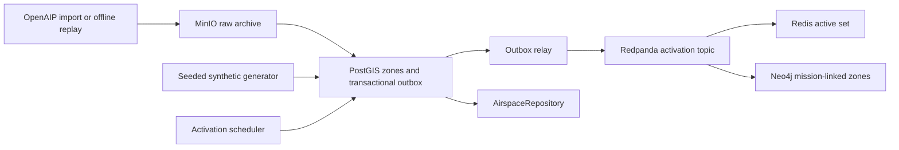

# Airspace: Implementation Plan

**Status: implemented on `dev-1`; pure contracts/generation and Compose rendering
were verified on 2026-10-04. Docker service integration remains an explicit
environment-dependent verification gate (see Section 11).**
Prepared on 2026-10-04 for `dev-1`. The original domain specification below is
retained as context. Sections 1-10 define the proposed implementation and resolve
gaps in its abbreviated schema and SQL examples.

## Purpose
Structure the sky: where flight is prohibited, restricted, reserved for missions, or civil-controlled, with altitude and time bounds.

## Source
- **Real**: OpenAIP (airspaces, airways, airports for India; free API key, GeoJSON/openAIP format).
- **Synthetic**: military zones (CAP orbits, tanker tracks, ingress/egress corridors, TRAs, missile-engagement zones, ADIZ polygon).

## Schema (`airspace_zone`)
| Field | Type | Notes |
|---|---|---|
| zone_id | text PK | |
| name | text | |
| type | text | PROHIBITED / RESTRICTED / DANGER / CTR / TMA / ADIZ / CAP / AAR_TRACK / CORRIDOR / TRA |
| geometry | geometry(Polygon,4326) | or LineString for corridors with `width_km` |
| floor_ft, ceiling_ft | int | AMSL |
| active_from, active_to | timestamptz | null = permanent |
| controlling_authority | text | civil ATC / IAF |
| source | text | openaip / synthetic |
| capacity_per_hour | int | max simultaneous flights (for deconfliction) |

## Generation rules
- Import OpenAIP India airspaces, clip to theatre bounding box.
- Add 6-10 CAP boxes (80x40 km) near borders, 3 tanker racetracks (200 km legs), 4 corridors (width 20 km), time-windowed TRAs activated by missions.
- Border/ADIZ polygon from Natural Earth buffered.

## Storage
```sql
CREATE TABLE airspace_zone (zone_id text PRIMARY KEY, name text, type text,
  geometry geometry(Geometry,4326), floor_ft int, ceiling_ft int,
  active_from timestamptz, active_to timestamptz, capacity_per_hour int, source text);
CREATE INDEX ON airspace_zone USING gist (geometry);
```
Active-zone cache in Redis: `airspace:active` (set of zone_ids) refreshed each minute. Neo4j `(:AirspaceZone)` nodes only for zones linked to missions. Raw OpenAIP files in MinIO `raw/openaip/`. Kafka `garuda.airspace.activation`.

## Key queries
```sql
-- zones intersecting a route at altitude and time
SELECT zone_id FROM airspace_zone
WHERE ST_Intersects(geometry, ST_SetSRID(ST_GeomFromGeoJSON(:route),4326))
  AND :alt_ft BETWEEN floor_ft AND ceiling_ft
  AND (active_from IS NULL OR :t BETWEEN active_from AND active_to);
```

## Consumers
Route planning (blocked cells), airspace deconfliction, harness `check_airspace`.

## 1. Scope and branch alignment

Implement validated airspace zones, reproducible synthetic generation, optional
OpenAIP ingestion, spatial/altitude/time queries, activation events, and
rebuildable Redis and Neo4j projections. Provide repository contracts for
`get_airspace`, route planning, deconfliction, and `check_airspace`.
Building the route solver, CP-SAT model, full mission service, or FastAPI/LLM
harness is outside this data-layer implementation.

The user's requested work is an implementation plan with Dockerized stores,
a Dockerfile for each added store, and one testing file covering each store.
[Storage architecture](storage_architecture.md) and
[synthetic generation](synthetic_data_generation.md) are design context;
their command examples and broader roadmap are not additional execution requests.
All commands and new paths below are planned deliverables.

Repository comparison performed without switching branches:

| Reference | Observed implementation | Decision for airspace |
|---|---|---|
| `main` at `9d4eb48` | `backend/src/garuda`, shared root Compose, mission/threat/weapon generators, seed writers, and graph sync | Reuse the ideas of validated generators, SQL ownership, mission identifiers, and constraint bootstrap; adapt them to the current branch |
| `dev-1` at `b5caee8` | `backend/app`, root `pyproject.toml`/`uv.lock`, `backend/migrations`, isolated `infra/adsb` and `infra/aircraft` stacks | Extend this layout, dependency tooling, async drivers, and domain CLI pattern |
| `dev-1` aircraft | Transactional state/outbox, version-guarded Redis/Neo4j projections, consolidated store test file | Follow these contracts and implement fully runnable workers |
| Both branches | No airspace application implementation; the three supplied specifications are identical between branches | Treat airspace as a new domain, not a port of existing code |

The branches have diverged from `f8d20b5`; `main`'s mission tables and modules
are absent from `dev-1`. Do not reference them as existing dependencies. Define
a mission-link adapter now and defer its cross-domain FK until missions exist
on this branch. Review the then-current migration head before implementation.

## 2. Ownership and schema decisions

| Store/service | Responsibility | Bootstrap |
|---|---|---|
| PostgreSQL + PostGIS, using the existing TimescaleDB image | Authoritative zones, schedules, mission links, import/run metadata, event audit, transactional outbox | Extensions, Alembic migration, reader login/grants |
| Redis | Current active-zone set and freshness/version metadata | Authenticated configuration; rebuilt from SQL |
| Neo4j Community | Only zones linked to missions and their relationships | Unique constraints; rebuilt from SQL links |
| MinIO | Immutable raw OpenAIP responses and import manifests under `raw/openaip/` | Idempotent bucket initialization |
| Redpanda (Kafka API) | `garuda.airspace.activation` delivery to projections | Idempotent topic initialization |

These are five services using technologies already present on `dev-1`.
There is no separate Timescale history requirement for airspace. Use ordinary
tables inside the pinned PostgreSQL/TimescaleDB service because the existing
ADS-B/aircraft Alembic chain invokes Timescale functions. A plain PostGIS-only
image would fail `alembic upgrade head` unless that chain were redesigned.

Add the following objects in an `airspace` schema:

| Object | Essential fields and constraints |
|---|---|
| `scenario_run` | `run_id`, effective seed, fixed UTC `start_at`, logical clock, config hash, generator version, input checksums, lifecycle status |
| `airspace_zone` | Original schema fields plus `run_id`, `controlling_authority`, `width_km`, optional centerline, `enabled`, `version`, `updated_at`, `last_event_id`, provenance/normalization metadata |
| `zone_activation_window` | `window_id`, zone FK, `[active_from, active_to)` UTC interval, optional mission identifier, version; supports repeat activations |
| `mission_zone_link` | Unique `(run_id, mission_id, zone_id)`, purpose, version; zone FK; explicit unresolved/resolved mission status |
| `import_batch` | Source, country, bounding box, input hash, manifest key, normalization version, accepted/rejected counts, completion status |
| `airspace_event` | Durable unique event identity and `(zone_id, version)` with payload hash and logical timestamp |
| `airspace_outbox` | Same event identity, full envelope, publication status, retry count and next attempt; committed with authoritative changes |

Use globally unique `zone_id` values namespaced by run and source; preserve the
original OpenAIP identifier separately. Repeated seed/import of identical input
in the same run is a no-op. Changed input gets a new version; reusing a run ID
with a different scenario hash is rejected. Mission links must belong to the
same run as their zone.

Resolve the source specification's ambiguities explicitly:

- **Geometry:** canonical `geometry` is a valid, nonempty Polygon/MultiPolygon
  in EPSG:4326, including holes. Retain an optional LineString centerline for
  corridors/tracks, but query their buffered footprint. A 20 km corridor has
  a 10 km buffer on either side; a zero-width line is insufficient.
- **Distance:** construct boxes, racetracks, and buffers in meters using a
  configured local projected CRS with `pyproj`/Shapely, then transform to 4326.
  Clip to the theatre, retain polygonal components, and report clipped features.
  Never buffer longitude/latitude coordinates as if degrees were kilometers.
- **Altitude:** query inputs are feet AMSL. Convert supported meter/foot AMSL
  values explicitly. Retain original units and datum. AGL, flight-level,
  surface, and unlimited limits require explicit handling: retain unresolved
  records with an unknown-altitude status, and surface them as uncertain spatial
  candidates. Do not relabel pressure altitude or AGL as AMSL. Exact terrain/QNH
  conversion is deferred to a supplied conversion adapter.
- **Bounds:** both floor and ceiling are nullable only for explicitly unknown
  or unbounded limits. Store that distinction in metadata; require
  `floor_ft <= ceiling_ft` when both are known. Unknown does not mean unrestricted.
- **Time:** a permanent zone has no windows and both original bounds null;
  a scheduled zone has complete paired bounds or explicit window rows. Reject
  half-specified intervals. Use half-open windows `[start, end)` throughout,
  replacing the illustrative `BETWEEN` endpoint behavior. Require `start < end`.
- **Repeated TRA use:** additional windows live in `zone_activation_window`;
  the original bounds represent the primary window for compatibility. Repository
  and projection logic use the normalized window table as the schedule authority.
  All times are timezone-aware UTC; injected clocks support simulated time.
- **Capacity:** retain `capacity_per_hour` for compatibility, but define it as
  the maximum simultaneous flights, matching the original note and CP-SAT
  cumulative constraint. Expose `max_simultaneous_flights` in typed query output.
  Null means unspecified; zero means no admitted flights; positive values are
  capacities. A true hourly throughput limit is a separate future field.
- **Types:** retain the documented enum. Represent synthetic missile-engagement
  zones as `RESTRICTED` with subtype `MISSILE_ENGAGEMENT`; do not silently invent
  another enum value or map unknown OpenAIP categories to a permissive category.
- **Policy:** active means temporally applicable, not automatically prohibited.
  Return type, controlling authority, capacity, mission reservation, and unknown
  conditions. The consumer applies blocked/clearance/reservation rules. A mission
  zone's availability window and a restriction's activation have distinct meanings.

Enforce geometry type/SRID/validity, enum, interval, positive width, capacity,
version, FK, and uniqueness constraints in PostgreSQL as well as Pydantic.
Add a GiST geometry index, an interval index for activation windows, and B-tree
indexes on run/type, mission links, and unpublished outbox rows.
The reader role can select bounded query data, but cannot write zones or read
outbox internals. Provision a real non-superuser reader login from environment
secrets; a `NOLOGIN` group alone does not demonstrate read-only access.

## 3. Deterministic generation and OpenAIP ingestion

Add `config/scenarios/airspace_demo.yaml` with a fixed UTC start, a 72-hour
horizon, explicit theatre bounding box, metric CRS, seed, zone altitude/capacity
defaults, border geometry checksum, and mission-linked activation windows.
Use seed precedence `--seed` > `GARUDA_SEED` > scenario seed and
`numpy.random.default_rng`. Keep generation pure and free of network/database I/O.

Default synthetic output:

- Eight CAP boxes, within the requested 6-10 range, nominally 80 by 40 km.
- Three tanker racetracks with 200 km straight legs and explicit turn radius
  and track width in configuration; persist their usable polygon footprints.
- Four corridors with total width 20 km and configured ingress/egress purpose.
- Configured mission TRAs with multiple activation/deactivation windows.
- A synthetic ADIZ derived from a pinned Natural Earth border subset and a
  configured metric buffer, plus configured fictional missile-engagement zones.

Use stable IDs, sorted output, canonical JSON, bounded placement attempts, and
explicit coordinate precision for fixed-seed snapshots. Record generator,
dependency, input, and CRS versions alongside the checksum. Validate nominal
dimensions before clipping and final containment afterward. A fixed seed alone
does not pin an upstream geography file or a geometry-library version.

For geography, store a small versioned GeoJSON subset plus its source/license
manifest and SHA-256. Natural Earth provides boundary geometry and configurable
viewpoints; it does not supply an operational ADIZ. Record the chosen viewpoint
and label the resulting ADIZ synthetic.
See the primary [Natural Earth boundary documentation](https://www.naturalearthdata.com/downloads/10m-cultural-vectors/10m-admin-0-boundary-lines/).

OpenAIP ingestion is a separate optional command:

1. Validate the current API contract against the
   [official OpenAIP API documentation](https://docs.openaip.net/), including
   authentication, country filter, pagination, categories, altitude datum,
   validity versus operating hours, and redistribution terms. The public docs
   were script-rendered and the schema endpoint was not retrievable during
   planning; exact endpoint parameters and numeric enum mappings remain an
   implementation validation gate rather than guessed constants.
2. Fetch India airspaces with explicit timeouts, pagination, bounded retry/backoff,
   rate-limit handling, and environment-only credentials. Never include API keys
   in archive manifests or logs. Airports/airways are separate future imports.
3. Archive exact raw response bytes first to bucket `garuda-airspace-raw`, key
   `raw/openaip/<input-sha256>/page-<n>.json`, with page checksums and a manifest.
   An archive failure prevents the corresponding SQL import.
4. Normalize supported categories and schedules, convert known altitude units,
   clip footprints, and report accepted/rejected/uncertain records with reasons.
   Missing or unparsed operating-hour data is unknown, not permanent activity.
5. Stage pages and promote a validated complete batch transactionally. Failed
   pagination or a partial batch must not deactivate records from a previous
   complete import. Replaying identical bytes must not create duplicate events.
6. Commit zones, schedules, provenance, event audit, and outbox together. SQL
   stores manifest references; orphaned archived batches remain identifiable
   for retry/reconciliation.

Offline generation, archive replay, and tests use checked-in fabricated OpenAIP
fixtures. Fixture metadata must distinguish fabricated civil examples from
retrieved data. Live credentials and live API availability are not test prerequisites.

## 4. Activation, event delivery, and projection recovery

Follow the existing event envelope: `event_id`, `type`, `entity_id`, UTC `ts`,
strictly increasing per-zone `version`, and `payload`. Include `run_id`, schedule,
zone attributes, linked mission identifiers, and effective clock in the payload
so consumers can reconstruct their projections from a newer full-state event.

Flow: archive/import or generator -> SQL transaction + outbox -> outbox relay ->
`garuda.airspace.activation` -> Redis and Neo4j consumers.



- Use a single partition key `zone_id`, three partitions, seven-day retention,
  `cleanup.policy=delete`, and acknowledged idempotent production. Keep SQL audit
  for durable replay; this topic is an event stream, not a compacted latest-state topic.
- Emit created/updated, activated/deactivated, disabled, and mission-link-change
  events. Schedule boundaries increment the same zone version under a row lock.
  The scheduler records all crossed boundaries during catch-up, even if an
  entire short window elapsed during downtime. Persist its logical-clock cursor.
- Commit SQL changes before publishing. Mark outbox entries published only after
  acknowledgement. Retry preserves event identity; delivery is at least once.
  Prevent concurrent relays from publishing one zone's versions out of order.
- Run a boundary scheduler and refresh the active set at startup and at least
  every 60 seconds. A simulation uses its logical clock rather than wall time.
  On schedule edits, immediately re-evaluate applicability at that clock.
- For Redis, use atomic version-guarded updates and a run-aware set
  `airspace:<run_id>:active`. Expose `airspace:active` for the explicitly selected
  run. Keep version and `evaluated_at`/clock metadata, never mix runs.
- Build full refreshes from a consistent SQL snapshot; publish staging keys
  atomically with a generation/cursor check so refresh cannot overwrite a newer
  event update. Handle an empty active set explicitly. Serialize concurrent
  scheduler/refresh work per run; on run switches replace alias and metadata together.
- Neo4j stores `(:AirspaceZone)` only when SQL contains mission links. Use a
  unique `zone_id`, stable mission keys, and a proposed relationship
  `(:Mission)-[:USES_AIRSPACE]->(:AirspaceZone)`. Standalone demo mission nodes
  must be labeled as reference stubs. The future mission adapter resolves them
  using `main`'s `mission_id` convention.
- Replace removed relationships and prune only orphaned airspace-owned nodes;
  never globally delete Mission nodes. Guard graph changes by version and consume
  transaction results before committing Kafka offsets.
- Both consumers commit offsets only after successful projection. Reject malformed
  envelopes to a bounded dead-letter path (`garuda.airspace.dead_letter`, also
  bootstrapped) rather than retrying a poison message forever.
- Reconciliation uses SQL as authority: remove stale membership/relationships,
  restore missing data, and repair corrupted same-version data. Merely reapplying
  events through a strict `new_version > old_version` guard cannot repair that drift.

Expose counts for import acceptance/rejection, pending outbox entries, relay
retries, consumer lag, scheduler delay, active-set freshness, and reconciliation.
Workers must run real loops with graceful shutdown and closed connections.
The current aircraft CLI has placeholder worker handlers; copy its module layout,
not those placeholders.

## 5. Repository and consumer contracts

Create `AirspaceRepository` with typed, bounded, parameterized methods:

| Method | Behavior |
|---|---|
| `get_zone(zone_id)` | Full zone, provenance, normalized altitude/schedule status |
| `list_zones(run_id, bbox, types, limit, cursor)` | Stable bounded pagination |
| `get_active_zones(run_id, at, ...)` | Evaluate normalized schedules at an explicit UTC instant |
| `get_zones_intersecting_route(run_id, route, alt_ft, at)` | GiST-assisted exact footprint intersection, altitude and time applicability |
| `get_zones_for_interval(run_id, route, altitude_block, since, until)` | Return every overlapping window and capacity for deconfliction |
| `get_mission_zones(run_id, mission_id)` | SQL-owned reservation/link lookup |
| `check_airspace(...)` | Return conflicts/clearance/reservation findings and unresolved candidates with reasons |

Use route boundary contact as an intersection; a route wholly inside a polygon
hole does not intersect its footprint. Altitude ranges are inclusive. Instant
checks use `start <= at < end`; interval overlap uses
`window_start < until AND window_end > since`. Permanent enabled zones apply
at all times. Validate SRID, coordinates, route type/complexity, timezone,
altitude block, interval ordering, page size, and statement timeout.

SQL is authoritative for exact and future-time queries. Redis may accelerate
current-set lookups only when its run/clock and freshness metadata match;
otherwise fall back to SQL. Return `data_as_of`, projection/source, provenance,
unknown-normalization reasons, and `truncated`; an incomplete result must not
be presented as proof of conflict-free airspace. Interval results expose pass
constraints for the future solver rather than claiming to solve deconfliction.
Harness callers use the reader-backed repository, never raw connections.

## 6. Planned file changes

New application files:

```text
backend/app/airspace_config.py
backend/app/airspace_cli.py
backend/app/schemas/airspace.py
backend/app/data/generators/airspace.py
backend/app/data/ingestors/openaip.py
backend/app/data/services/airspace.py
backend/app/data/repositories/airspace.py
backend/app/data/outbox/airspace.py
backend/app/data/consumers/airspace_live.py
backend/app/data/consumers/airspace_graph.py
backend/app/data/simulation/airspace.py
backend/app/data/reconciliation/airspace.py
backend/app/data/replay/airspace.py
backend/app/data/airspace_archive.py
backend/migrations/versions/20261004_03_airspace.py
config/scenarios/airspace_demo.yaml
config/geography/airspace_border.geojson
config/geography/airspace_border.manifest.json
tests/fixtures/airspace/fabricated_openaip.json
tests/fixtures/airspace/seed42_snapshot.json
tests/fixtures/airspace/seed42_snapshot.json.sha256
tests/integration/test_airspace_stores.py
```

New deployment files; each persistent store/broker has its own Dockerfile:

```text
infra/airspace/compose.yaml
infra/airspace/compose.test.yaml
infra/airspace/.env.example
infra/airspace/README.md
infra/airspace/postgres/Dockerfile
infra/airspace/postgres/init/020_extensions.sql
infra/airspace/postgres/init/030_reader.sh
infra/airspace/redis/Dockerfile
infra/airspace/redis/redis.conf
infra/airspace/neo4j/Dockerfile
infra/airspace/neo4j/init/constraints.cypher
infra/airspace/minio/Dockerfile
infra/airspace/minio/init-bucket.py
infra/airspace/redpanda/Dockerfile
infra/airspace/redpanda/init-topics.sh
infra/airspace/app/Dockerfile
infra/airspace/tests/Dockerfile
infra/airspace/tests/requirements.in
infra/airspace/tests/requirements.lock
```

Update `pyproject.toml`, `uv.lock`, package exports, `.dockerignore`, and the root
README. Add exact compatible Shapely/pyproj pins and include them in both locks.
Register the `integration` pytest marker. Reuse existing asyncpg, Neo4j async,
redis.asyncio, aiokafka, boto3, httpx, NumPy, Pydantic, and YAML dependencies.
Use existing archive/client helpers only where their contracts fit; avoid
importing aircraft/ADS-B domain schemas into airspace.

The migration's proposed revision is `20261004_airspace`, descending from
`20261004_aircraft`; adjust filename/revision if the head changes before work.
Run the complete existing chain and scope downgrade to airspace-owned objects.
Existing stacks running `upgrade head` must remain compatible with the new revision.

## 7. Docker reproducibility and operational commands

Use Compose project `garuda-airspace`, project-scoped networks and named volumes, and
localhost-bound configurable ports. Proposed defaults are PostgreSQL 35432,
Redis 36379, Neo4j Bolt 37687/HTTP 37474, Kafka 39092, and MinIO 39000/39001;
they do not collide with the existing domain stack defaults. Derive Kafka's
external listener and advertised port from the same environment variable.

Reuse the full tag-and-digest pins already committed in `infra/aircraft` for
PostgreSQL/TimescaleDB, Redis, Neo4j, Redpanda, and Python, and the MinIO pin in
`infra/adsb/minio/Dockerfile`. Verify pulls/builds at implementation time before
recording them as tested. Keep `linux/amd64` consistent with existing stacks;
do not claim unverified ARM support. Use frozen `uv.lock` for application builds
and hash-verified test dependencies; no floating `latest` or unpinned apt installs.

Compose services include the five stores, idempotent migrate/topic/constraint/
bucket initialization jobs, separate outbox/live/graph/scheduler workers, and
a test runner. Workers and tests wait for healthy services and completed bootstrap.
MinIO readiness must include a real S3 operation; `minio --version` alone is
not readiness. Create the reader group, login, and membership during container
initialization. Alembic idempotently creates/grants the group without assuming
that login exists on other domain stacks. Reader checks use that login;
writer/outbox checks use writer credentials.
Use `AIRSPACE_*` settings and the existing `GARUDA_POSTGRES_DSN` migration override.
Keep secrets out of build contexts and commit only `.env.example`.

Planned CLI: `garuda-airspace generate`, `import-openaip`, `replay`,
`worker <outbox|live|graph|scheduler>`, `reconcile`, `query`, and `check`.
Generation supports `--config`, `--seed`, and `--run-id`; replay/import support
input checksum and explicit source labeling. All commands must be executable.

Expected clean-start sequence from the repository root, after implementation:

```powershell
if (-not (Test-Path infra/airspace/.env)) {
    Copy-Item infra/airspace/.env.example infra/airspace/.env
}
docker compose --env-file infra/airspace/.env -f infra/airspace/compose.yaml config --quiet
docker compose --env-file infra/airspace/.env -f infra/airspace/compose.yaml --profile app up -d --build
docker compose --env-file infra/airspace/.env -f infra/airspace/compose.yaml run --rm airspace-cli generate --config config/scenarios/airspace_demo.yaml --seed 42 --run-id demo-1
docker compose -p garuda-airspace-test --env-file infra/airspace/.env -f infra/airspace/compose.yaml -f infra/airspace/compose.test.yaml --profile test run --build --rm store-tests
docker compose -p garuda-airspace-test --env-file infra/airspace/.env -f infra/airspace/compose.yaml -f infra/airspace/compose.test.yaml down
docker compose --env-file infra/airspace/.env -f infra/airspace/compose.yaml --profile app down
```

Define `airspace-cli` with the `garuda-airspace` entrypoint and bootstrap
dependencies so it can be used by `compose run`. The test container's nonzero
exit propagates to the shell. Normal `down` preserves volumes; document an
explicit airspace-only reset separately. The test override removes host port
publication and supplies test-only settings; its separate Compose project also
isolates networks and volumes, so it can run alongside the demo without changing
the demo's active-set alias. Avoid fixed container/network/volume names that would
defeat project isolation.

## 8. One consolidated testing file

Create **only one new executable Python test file**:
`tests/integration/test_airspace_stores.py`. It contains a named case for each
store, plus parameterized pure validation/generation cases and a pipeline case.
Do not split store tests into five files. Fixtures and dependency lockfiles are
supporting data, not additional test modules.

Mark only container-dependent cases `integration`; pure cases run during normal
pytest without Docker. An explicit `GARUDA_AIRSPACE_INTEGRATION=1` enables real
store tests and is always set in the test container. An enabled integration run
must fail on missing/unhealthy dependencies, not silently skip them.

| Case in the single file | Required behavior to prove |
|---|---|
| `test_airspace_validation_and_generation` (parameterized) | Seed-42 snapshot/hash, changed seed, ID stability, nominal metric dimensions, valid clipped footprints/holes, enum/capacity/interval validation, altitude conversions and unknown handling |
| `test_postgres_airspace_geometry_and_outbox` | Full migration chain, GiST/index presence, route inside/outside/touching/hole cases, corridor-width intersection, altitude bounds and unknowns, repeated/permanent windows and endpoint/interval overlap, rollback and idempotent outbox, reader SELECT succeeds and writes fail |
| `test_redis_airspace_active_set` | Event-driven membership, 60-second refresh at injected times, empty set, run isolation, duplicates/older versions ignored, atomic refresh race, stale-cache SQL fallback, rebuild after lost/corrupted state |
| `test_neo4j_airspace_mission_links` | Unique constraints, linked zones only, idempotent/stale events, removal of obsolete links/orphan zones, preserved Mission nodes, run isolation, same-version drift repaired |
| `test_minio_openaip_archive_and_replay` | Real byte upload/download and SHA-256 equality, idempotent manifests, no secret leakage, fabricated source labels, SQL provenance reference, archived import retry, checksum mismatch and failed archive preventing import |
| `test_redpanda_airspace_activation_roundtrip` | Topic partitions/retention/cleanup policy, actual producer acknowledgment AND consumer key/envelope roundtrip, per-zone versions, unique test group, offset replay, malformed-event dead-letter handling |
| `test_airspace_pipeline_and_recovery` | Offline import + synthetic seed -> SQL/outbox -> real Kafka consumers -> Redis/Neo4j -> repository result; repeated seed/import remains idempotent; broker outage leaves durable outbox and recovers; scheduler catch-up and forced projection drift converge |

Use deterministic clocks and unique test run IDs, bounded readiness/consumer
polling, and explicit cleanup of only test-owned rows/keys/objects/graph links.
Avoid global `FLUSHDB`, graph deletion, fixed sleep assertions, and fresh topics
that bypass validation of the bootstrapped domain topic. Exercise real command
and worker entrypoints in the pipeline case, not only direct projection calls.
Keep pure test and integration selection documented, with lock regeneration and
fixture update procedures in `infra/airspace/README.md`.

## 9. Implementation sequence and acceptance gates

1. **Contracts and fixtures:** implement config/models, geometry and altitude
   normalization, deterministic generator, pinned geography, fabricated input,
   and snapshot. Gate: pure cases in the consolidated file pass without network.
2. **Store stack and migration:** add all Dockerfiles, Compose, secrets template,
   bootstraps, schema/indexes/reader role, locks, and `.dockerignore` exceptions.
   Gate: Compose validates, clean builds succeed, all five stores are ready,
   the complete chain upgrades, and bootstrap assertions in the consolidated
   cases pass. Full behavior assertions are enabled as their application paths
   are implemented in steps 3-4.
3. **SQL write/read path and archive:** implement atomic seed/import, command
   service, MinIO manifests/replay, and bounded repository queries. Gate:
   provenance, rollback, unknown normalization, idempotency, and query cases pass.
4. **Events and projections:** implement outbox relay, actual consumers,
   scheduler/refresh, mission-reference adapter, and reconciliation. Gate:
   real Kafka roundtrip, duplicates, schedule boundaries, drift repair, and
   outage recovery pass.
5. **Operational completion:** wire every CLI/worker, complete README/root links,
   run the documented clean-start/test flow twice, and verify restart persistence.
   Gate: one test file proves all five stores and the complete offline pipeline.
6. **Optional live OpenAIP validation:** validate the provider contract with
   credentials when available and document results. Offline delivery remains
   usable; do not claim a live import was verified if it was not run.

Run the existing ADS-B/aircraft pure suites and relevant existing Docker store
suites after changing shared dependencies, build rules, or migrations. Recheck
their migrations on their pinned images. Avoid changing existing domain behavior
solely to make the new airspace suite pass.

## 10. Completion criteria and remaining external dependencies

The implementation is complete when a clean clone can build and start the
isolated Docker stack, seed/replay without provider credentials, answer exact
spatial/altitude/time queries, deliver activation changes to both projections,
recover from broker/cache/graph failures, and pass the one consolidated test file.
Image digests, dependency hashes, input manifests, seed, logical start, and
generator version must be recorded for reproducibility.

Live OpenAIP field mappings/access/licensing are validated against the provider
before enabling live ingestion. Terrain/QNH conversion and the full mission
service are explicit adapters rather than assumed dependencies. Unknown provider
data must remain visible in repository findings. Decisions above are proposed
defaults for this implementation; none require merging or switching to `main`.

## 11. Actual implementation status (2026-10-04)

Implemented: validated airspace contracts; explicit AMSL/unknown altitude
normalization; deterministic metric synthetic geometry; a pinned geography input
and seed-42 snapshot; fabricated OpenAIP fixture/replay archive; the
`20261004_airspace` PostGIS migration; atomic zone/outbox writes; bounded SQL
repository reads; Redis and Neo4j version-guarded projections; a Kafka outbox
relay; a logical-clock scheduler; reconciliation; and the `garuda-airspace`
CLI. The isolated stack contains digest-pinned store Dockerfiles, persistent
volumes, health checks, bootstrap jobs, a real reader login, and the test
override. The one new executable suite is
`tests/integration/test_airspace_stores.py`.

Verified locally: normal and test Compose rendering; Python compilation;
deterministic snapshot generation; and the pure airspace plus existing
ADS-B/aircraft application tests (`13 passed, 6 Docker cases skipped` outside
the test container). The documented clean start also passed on the isolated
stack: all five stores became healthy, Alembic upgraded the full chain, MinIO
performed an authenticated S3 operation, Redpanda bootstrapped both topics,
Neo4j installed constraints, and `generate --seed 42 --run-id demo-1` persisted
20 zones and 20 outbox events. The outbox relay and real Kafka consumers built a
Redis active set of 18 permanent zones. The consolidated test container passed
all eight cases. A reader login could select zones but was denied a schema write.
Restarting PostgreSQL, Redis, and MinIO retained the 20 zones, 20 delivered
outbox rows, 18 active-set members, and raw bucket. Live OpenAIP remains
deliberately disabled until the current provider contract, credentials, and
redistribution terms are validated.
