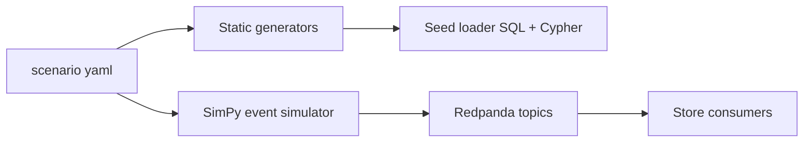

# Synthetic Data Generation

## Goals
Reproducible, realistic-looking, unclassified data for all non-public domains, plus a live event simulator to exercise dynamic retasking.

## Tooling
Python: `numpy` (distributions), `Faker` (names), `SimPy` (discrete-event sim), `pydantic` (validation), `shapely` (geometry), `confluent-kafka`/`aiokafka` (publish). A fixed seed `GARUDA_SEED` drives `numpy.random.default_rng`.

## Pipeline

1. **Static generators** (`generators/`): bases, squadrons, aircraft, crew, weapons, loads, threats, targets, missions, synthetic airspace. Output validated Pydantic objects, written to Postgres, Neo4j, Redis.
2. **Event simulator**: SimPy processes advance a simulated clock (speed factor configurable, e.g. 60x):
   - aircraft failures (hazard rises with hours since inspection)
   - maintenance completion, fuel burn/refuel, sortie turnarounds
   - crew duty and rest accumulation
   - threat pop-ups and movement
   - mission arrivals (Poisson), cancellations
   - weather overrides
3. **Scripted injections**: `POST /scenario/inject-event` with templates (`aircraft_nmc`, `new_sam`, `base_closed`, `p1_request`, `tanker_lost`).

## Correlation rules (realism)
- Older fleets: lower FMC rate, longer repair.
- Fatigue increases with consecutive sorties; surge periods increase failure hazard by 1.3x.
- Weapon stock drops with strikes; resupply every 24 h with delay.
- Threat density higher near border; targets placed near threat clusters.

## Config example
```yaml
seed: 42
horizon_hours: 72
bases: 7
fleet: {Su-30MKI: 40, Rafale: 24, Tejas: 24, Mirage-2000: 18, Jaguar: 12, C-130J: 8, IL-78: 6, AEW: 4, Heli: 14}
crew_per_airframe: 2.0
events:
  - {t: 6, type: aircraft_nmc, count: 3}
  - {t: 14, type: new_sam, near: B2}
  - {t: 20, type: base_closed, base: B5, reason: fog}
```

## Validation
Schema checks, referential integrity (every aircraft has base and squadron), distribution tests (KS test vs target), load-config weight limits, snapshot test with fixed seed.

## CLI
`python -m garuda.generate --config scenario.yaml --seed 42` and `python -m garuda.simulate --speed 60`.
