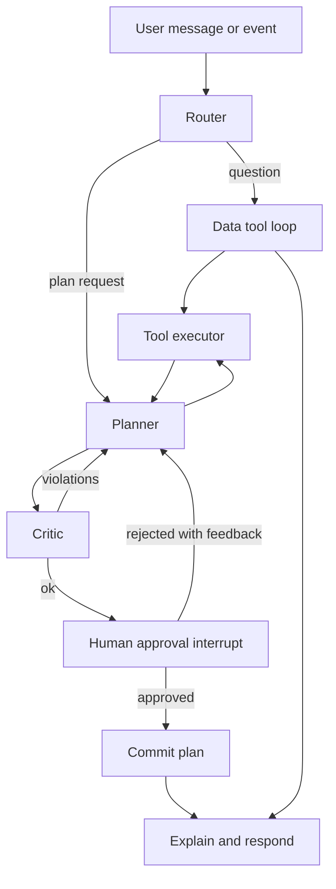

# LLM Harness Overview

The harness lets an LLM agent search GARUDA data and call optimization/ML tools, under human control. Built with **LangGraph** inside **FastAPI**.

## Graph


## Nodes
| Node | Role |
|---|---|
| Router | Classifies intent: QUERY, PLAN, RETASK, WHAT_IF, EXPLAIN |
| Planner | LLM decides next tool call(s) or final answer; keeps a plan scratchpad |
| Retriever / ToolExec | Executes validated tool calls (async), returns structured results |
| Critic | Deterministic checks: constraints satisfied, KPIs present, stale data (>N min), solver status OPTIMAL/FEASIBLE |
| Approval | LangGraph `interrupt()` waiting for commander decision |
| Commit | Writes plan version, publishes `garuda.plan.event`, updates Neo4j |
| Respond | Natural-language summary with citations to tool outputs |

## State schema
```python
class AgentState(TypedDict):
    messages: Annotated[list[AnyMessage], add_messages]
    intent: str
    scenario_time: datetime
    working_data: dict[str, Any]       # cached tool results by key
    draft_plan: PlanDraft | None
    critic_report: CriticReport | None
    approval: Literal["pending","approved","rejected"] | None
    tool_budget: int                   # max tool calls per turn
```
Checkpointer: `AsyncPostgresSaver` so sessions and approval waits survive restarts.

## Principles
- LLM outputs only tool calls, summaries and explanations; numbers come from tools.
- Tool results are summarised/truncated before returning to the LLM (e.g. top-N rows plus counts) to protect context.
- LLM adapter interface `LLMClient.chat(messages, tools)` with OpenAI and Anthropic implementations.
- Streaming of tokens and tool events via SSE.
- System prompt includes role, scenario clock, safety rules, tool-selection guidance and "never invent data".

## Typical flow: "Aircraft SU-A0123 went NMC. Retask."
1. Router -> RETASK. 2. Planner calls `get_mission_requests(assigned_aircraft=...)`. 3. calls `retask_rolling_horizon(event=...)`. 4. Critic verifies. 5. Planner calls `evaluate_plan_monte_carlo`. 6. Approval. 7. Respond with diff vs. old plan.

## Package layout
`harness/graph.py`, `state.py`, `nodes/*.py`, `tools/data/*.py`, `tools/optimization/*.py`, `llm/clients.py`, `prompts/`.
