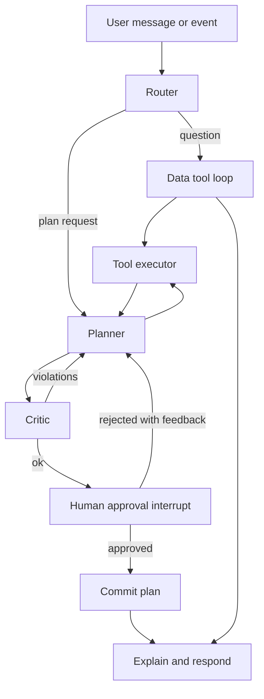

# LLM Harness Overview

The harness lets an LLM agent search GARUDA data and call optimization/ML tools, under human control. Built with **LangGraph** inside **FastAPI**.

## Graph


## Nodes
| Node | Role |
|---|---|
| Router | Classifies intent: QUERY, PLAN, RETASK, WHAT_IF, EXPLAIN |
| Planner | LLM decides next tool call(s) or final answer; keeps a plan scratchpad |
| Retriever / ToolExec | Executes validated tool calls (async), returns structured results |
| Critic | Deterministic checks: constraints satisfied, KPIs present, stale data (>N min), solver status OPTIMAL/FEASIBLE |
| Approval | LangGraph `interrupt()` waiting for commander decision |
| Commit | Writes plan version, publishes `garuda.plan.event`, updates Neo4j |
| Respond | Natural-language summary with citations to tool outputs |

## State schema
```python
class AgentState(TypedDict):
    messages: Annotated[list[AnyMessage], add_messages]
    intent: str
    scenario_time: datetime
    working_data: dict[str, Any]       # cached tool results by key
    draft_plan: PlanDraft | None
    critic_report: CriticReport | None
    approval: Literal["pending","approved","rejected"] | None
    tool_budget: int                   # max tool calls per turn
```
Checkpointer: `AsyncPostgresSaver` so sessions and approval waits survive restarts.

## Principles
- LLM outputs only tool calls, summaries and explanations; numbers come from tools.
- Tool results are summarised/truncated before returning to the LLM (e.g. top-N rows plus counts) to protect context.
- LLM adapter interface `LLMClient.chat(messages, tools)` with OpenAI and Anthropic implementations.
- Streaming of tokens and tool events via SSE.
- System prompt includes role, scenario clock, safety rules, tool-selection guidance and "never invent data".

## Typical flow: "Aircraft SU-A0123 went NMC. Retask."
1. Router -> RETASK. 2. Planner calls `get_mission_requests(assigned_aircraft=...)`. 3. calls `retask_rolling_horizon(event=...)`. 4. Critic verifies. 5. Planner calls `evaluate_plan_monte_carlo`. 6. Approval. 7. Respond with diff vs. old plan.

## Main agent (`harness/main/`)
The main agent is the entry point that sits above the sub-agents (retrieval, spatial, ontology, simulation, and the nine optimizer task agents). It has two modes.

- **Agent mode**: quick read-only lookups. The model calls the query agents (at most 4 calls), then `respond`. If the request needs an optimizer it calls `switch_to_plan`.
- **Plan mode**:
  1. **Discovery**: query agents and `ask_question` to the commander, ending in `propose_plan`.
  2. **Approval**: the commander approves the work plan, or rejects it with feedback, which produces a new version.
  3. **Execute**: each step is delegated to one sub-agent with its objective, context, success criteria, and the compact outputs of its `inputs_from` steps.
  4. **Review**: after every step the model checks the criteria and calls `continue_plan` (edits context or criteria of later steps, no approval), `revise_plan` (adding, removing, reordering, or reassigning steps needs approval again), `retry_step` (once per step), or `abort`.
  5. **Respond**: final answer citing step ids.

A `choose_mode` router picks the mode; `run_main(mode="agent" | "plan")` skips it.

When a sub-agent asks a question, the main model answers it from the request, earlier answers, or outputs (`answer_subagent`), or escalates to the commander (`ask_human`). The answer continues the same sub-agent session. Each step allows at most 3 such rounds.

The **work plan is not the commit plan**. It only lists delegation steps; approving it lets sub-agents run. `commit_plan` still needs the HMAC approval token from the API, and the main agent never calls it.

```python
result = await run_main("Aircraft SU-A0123 went NMC. Retask.", ctx)
while result.status in ("awaiting_answer", "awaiting_approval"):
    if result.status == "awaiting_answer":
        result = await resume_main(result.session, ctx, answer=ask_commander(result.question))
    else:
        result = await resume_main(result.session, ctx, approval=PlanApproval(approved=True))
```

State lives on an in-memory `MainSession` (no checkpointer yet); a paused result carries it, and `resume_main` continues from the same phase. The master prompt in `harness/main/prompts.py` describes every sub-agent, the standard operating procedures (new plan, retask, what-if, route, capacity), plan-writing rules, and review rules; every phase sees it in full.

## Package layout
`harness/graph.py`, `state.py`, `nodes/*.py`, `tools/data/*.py`, `tools/optimization/*.py`, `llm/clients.py`, `prompts/`.
