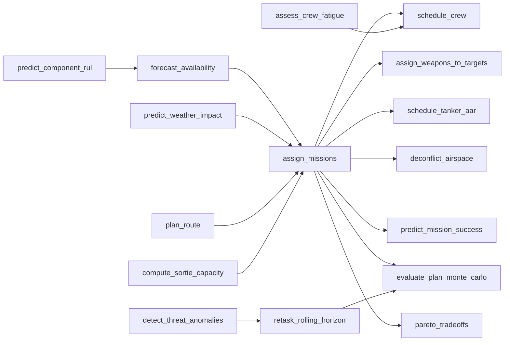

# Optimization and Predictive Layer - Index

Each algorithm is exposed as a typed tool to the LLM harness (see `../02_llm_harness/tool_catalog.md`).

| Tool | Doc | Technique | Library |
|---|---|---|---|
| `assign_missions` | [milp_mission_aircraft_assignment](milp_mission_aircraft_assignment.md) | MILP | PuLP/HiGHS, OR-Tools |
| `schedule_crew` | [cpsat_crew_scheduling](cpsat_crew_scheduling.md) | CP-SAT | OR-Tools |
| `assign_weapons_to_targets` | [weapon_target_assignment](weapon_target_assignment.md) | Nonlinear WTA, greedy + MILP | PuLP |
| `compute_sortie_capacity` | [lp_sortie_generation_rate](lp_sortie_generation_rate.md) | LP | PuLP/HiGHS |
| `plan_route` | [threat_aware_route_planning](threat_aware_route_planning.md) | A*, Theta*, RRT* | NumPy |
| `schedule_tanker_aar` | [vrp_tanker_aar_scheduling](vrp_tanker_aar_scheduling.md) | VRPTW | OR-Tools routing |
| `deconflict_airspace` | [cpsat_airspace_deconfliction](cpsat_airspace_deconfliction.md) | CP-SAT cumulative | OR-Tools |
| `retask_rolling_horizon` | [rolling_horizon_dynamic_retasking](rolling_horizon_dynamic_retasking.md) | Warm-started MILP, LNS | PuLP/OR-Tools |
| `pareto_tradeoffs` | [multi_objective_tradeoffs](multi_objective_tradeoffs.md) | Epsilon-constraint, NSGA-II | pymoo |
| `forecast_availability` | [aircraft_availability_forecast](aircraft_availability_forecast.md) | Gradient boosting | XGBoost |
| `predict_component_rul` | [component_failure_survival](component_failure_survival.md) | Weibull, Cox PH | lifelines |
| `assess_crew_fatigue` | [crew_fatigue_model](crew_fatigue_model.md) | Biomathematical + ML | NumPy |
| `predict_weather_impact` | [weather_impact_prediction](weather_impact_prediction.md) | Classifier | LightGBM |
| `detect_threat_anomalies` | [threat_anomaly_detection](threat_anomaly_detection.md) | Isolation Forest, HDBSCAN, CUSUM | scikit-learn |
| `predict_mission_success` | [mission_success_probability](mission_success_probability.md) | GBM + SHAP surrogate | XGBoost, shap |
| `evaluate_plan_monte_carlo` | [monte_carlo_plan_evaluation](monte_carlo_plan_evaluation.md) | Monte Carlo | NumPy, joblib |
| `rl_retask` (stretch) | [rl_retasking_agent](rl_retasking_agent.md) | PPO | SB3 |

## Dependency graph

## Suggested build order (hackathon)
1. `compute_sortie_capacity`, `assign_missions`, `plan_route` (core value).
2. `schedule_crew`, `retask_rolling_horizon`, `evaluate_plan_monte_carlo`.
3. `forecast_availability`, `predict_weather_impact`, `assign_weapons_to_targets`.
4. `schedule_tanker_aar`, `deconflict_airspace`, `pareto_tradeoffs`.
5. Remaining ML and stretch (RL).

## Common conventions
Every tool: Pydantic in/out, `time_limit_s`, deterministic seed, returns status, KPIs, explanation, `data_as_of`; solver outputs are re-validated by an independent plan validator.
